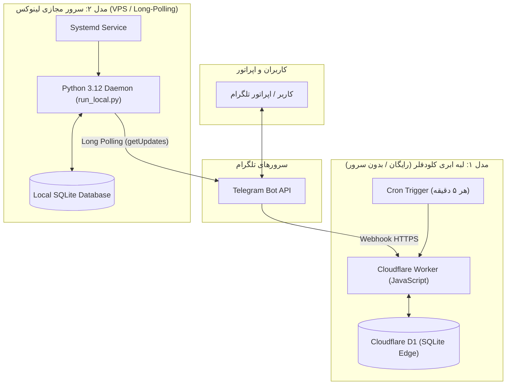

# راهنمای جامع استقرار، نگهداری و بهره‌برداری سامانه «کافی نت لیمو»
**نسخه سند:** 1.0.0  
**منطقه زمانی سامانه:** `Asia/Tehran` (UTC+03:30)  
**تقویم مورد استفاده:** هجری شمسی (جلالی)  

---

## ۱. نمای کلی معماری و مدل‌های استقرار

سامانه «کافی نت لیمو» با هدف پایداری حداکثری و استقلال زیرساختی، با **معماری دومنظوره (Dual-Mode)** طراحی گردیده است:



| ویژگی | مدل ۱: ابری Cloudflare Workers | مدل ۲: سرور مجازی لینوکس (VPS) |
| :--- | :--- | :--- |
| **هزینه ماهانه** | **۰ تومان (کاملاً رایگان در Free Tier)** | حدود ۱۰۰ تا ۲۰۰ هزار تومان (VPS ایرانی) یا ۳ الی ۵ دلار (VPS خارجی) |
| **نیاز به سرور فیزیکی/مجازی** | ندارد (Serverless) | دارد (حداقل 1 Core CPU و 1GB RAM) |
| **روش دریافت پیام** | Webhook مستقیم HTTPS | Long-Polling (بدون نیاز به دامنه یا IP اختصاصی) |
| **پایگاه داده** | Cloudflare D1 (SQLite ابری توزیع‌شده) | SQLite محلی ذخیره‌شده روی دیسک سرور |
| **وضعیت فعلی** | **هم‌اکنون فعال و مستقر است** | آماده اجرای فوری با یک دستور |

---

## ۲. گام‌های پیش‌نیاز: ایجاد ربات در BotFather

۱. در تلگرام وارد ربات رسمی **[@BotFather](https://t.me/BotFather)** شوید.  
۲. دستور `/newbot` را ارسال کنید.  
۳. نام نمایشی ربات را وارد کنید: `کافی نت لیمو`  
۴. شناسه کاربری (Username) دلخواه را وارد فرمایید (مثال: `LimoCafeBot` یا `LimoNetBot`).  
۵. توکن محرمانه دریافت‌شده را کپی کنید (این توکن کلید امنیتی بات شماست؛ طبق بند ۵ سند حاکم نباید افشا شود).  
۶. جهت معرفی دستورات رسمی به تلگرام، دستور `/setcommands` را به BotFather ارسال کرده و متن زیر را بفرستید:

```text
start - منوی اصلی خدمات و امکانات
track - پیگیری وضعیت پرونده با کد رهگیری
orders - کارتابل سفارش‌های اپراتور (ویژه مدیر)
stats - آمار و وضعیت سامانه (ویژه مدیر)
health - ارزیابی سلامت دیتابیس و سیستم (ویژه مدیر)
backup - خلاصه نسخه پشتیبان داده‌ها (ویژه مدیر)
help - راهنمای سامانه کافی نت لیمو
```

۷. شناسه عددی اکانت تلگرام خود (مدیر سیستم) را با استفاده از ربات‌هایی نظیر `@userinfobot` به دست آورید (مثال: `123456789`).

---

## ۳. روش اول: بهره‌برداری بر روی کلودفلر (Cloudflare Edge)

سامانه شما در حال حاضر روی کلودفلر مستقر است:  
**نشانی اندپوینت زنده:** `https://limo-cafe-bot.bakhtar-visasup.workers.dev`

### ۳.۱. تنظیم متغیرهای محرمانه (Secrets)
در خط فرمان پروژه دستورات زیر را اجرا کنید (یا از پنل کاربری Cloudflare Dashboard در تب Variables وارد نمایید):

```bash
# تنظیم توکن ربات تلگرام
npx wrangler secret put BOT_TOKEN --config=./cloudflare/wrangler.toml

# تنظیم شناسه عددی مدیر ارشد
npx wrangler secret put ADMIN_ID --config=./cloudflare/wrangler.toml
```

### ۳.۲. فعال‌سازی وب‌هوک با اسکریپت امن
پس از تنظیم متغیرها، وب‌هوک را با اسکریپت آماده ثبت فرمایید:

```bash
python scripts/setup_webhook.py --token "توکن_شما" set --url "https://limo-cafe-bot.bakhtar-visasup.workers.dev"
```

جهت استعلام وضعیت اتصال:
```bash
python scripts/setup_webhook.py --token "توکن_شما" info
```

---

## ۴. روش دوم: استقرار بر روی سرور مجازی لینوکس (Linux VPS)

در صورتی که در آینده مایل به خرید سرور مجازی اختصاصی لینوکس بودید:

### ۴.۱. مشخصات و هزینه سرور پیشنهادی
- **سیستم‌عامل:** Ubuntu 22.04 LTS یا 24.04 LTS
- **حداقل پردازنده (CPU):** ۱ هسته (1 vCPU)
- **حداقل حافظه رم (RAM):** ۱ گیگابایت (1 GB)
- **فضای دیسک:** ۱۰ گیگابایت SSD/NVMe
- **تخمین هزینه:** شرکت‌های ارائه‌دهنده سرور ابری داخلی (نظیر ابر آروان، پارس‌پک، هاست دی‌ال یا مبین‌هاست) این سرور را با ماهیانه بین ۱۰۰ تا ۲۰۰ هزار تومان ارائه می‌دهند. برای سرورهای خارجی (Hetzner, DigitalOcean) هزینه حدود ۳ الی ۴ یورو در ماه است.

### ۴.۲. نصب پیش‌نیازها و آماده‌سازی در سرور
پس از اتصال به سرور از طریق SSH:

```bash
# ۱. به‌روزرسانی مخازن لینوکس و نصب پایتون
sudo apt update && sudo apt upgrade -y
sudo apt install python3 python3-pip python3-venv git -y

# ۲. ایجاد پوشه کاری و انتقال کدهای پروژه
mkdir -p /opt/limo-bot
cd /opt/limo-bot

# ۳. ایجاد و فعال‌سازی محیط مجازی پایتون
python3 -m venv venv
source venv/bin/activate

# ۴. نصب نیازمندی‌های استاندارد
pip install sqlalchemy pydantic

# ۵. ایجاد فایل تنظیمات .env
cat << 'EOF' > .env
BOT_TOKEN=123456789:ABCdefGhI_توکن_واقعی_شما
ADMIN_ID=987654321
DATABASE_URL=sqlite:///storage/limo.db
EOF

# ۶. آماده‌سازی و ساخت دیتابیس محلی
python scripts/init_db.py --recreate
```

### ۴.۳. ایجاد سرویس دائمی لینوکس (Systemd Service)
جهت اجرای ۲۴ ساعته ربات به عنوان دیمن پس‌زمینه و بالا آمدن خودکار پس از روشن شدن یا ریبوت سرور:

```bash
sudo cat << 'EOF' > /etc/systemd/system/limo-bot.service
[Unit]
Description=Limo Cafe Telegram Bot & Smart Monitor Service
After=network.target

[Service]
Type=simple
User=root
WorkingDirectory=/opt/limo-bot
ExecStart=/opt/limo-bot/venv/bin/python /opt/limo-bot/run_local.py
Restart=always
RestartSec=5
StandardOutput=journal
StandardError=journal
Environment=PYTHONUNBUFFERED=1

[Install]
WantedBy=multi-user.target
EOF
```

فعال‌سازی و شروع سرویس:
```bash
sudo systemctl daemon-reload
sudo systemctl enable limo-bot
sudo systemctl start limo-bot
```

مشاهده لاگ‌های زنده ربات:
```bash
journalctl -u limo-bot -f
```

---

## ۵. راهنمای سوییچ میان وب‌هوک (کلودفلر) و پولینگ (سرور لینوکس)

تلگرام در آن واحد فقط یکی از دو حالت **Webhook** یا **Long-Polling** را مجاز می‌داند:

- **تغییر از کلودفلر به سرور لینوکس (پولینگ):**  
  اسکریپت `run_local.py` به صورت خودکار وب‌هوک قبلی را حذف و حالت پولینگ را فعال می‌سازد. همچنین می‌توانید دستی وب‌هوک را حذف کنید:
  ```bash
  python scripts/setup_webhook.py --token "توکن" delete
  ```
- **تغییر از سرور لینوکس به کلودفلر (وب‌هوک):**  
  ابتدا سرویس لینوکس را متوقف کرده (`sudo systemctl stop limo-bot`) و سپس دستور `set` را اجرا کنید:
  ```bash
  python scripts/setup_webhook.py --token "توکن" set --url "https://limo-cafe-bot.bakhtar-visasup.workers.dev"
  ```

---

## ۶. راهنمای عملیاتی و اپراتوری سامانه (Operator Runbook)

### ۶.۱. چرخه پردازش سفارشات مشتریان
۱. متقاضی از منوی ربات خدمت موردنظر (مثلاً تاییدیه تحصیلی) را انتخاب کرده و فیلدها و تصویر مدرک را می‌فرستد.  
۲. پس از تایید متقاضی، یک کد رهگیری یکتا با فرمت `LIMO-1405-XXXXX` صادر می‌شود.  
۳. وضعیت اولیه پرونده **«⏳ در انتظار بررسی اپراتور» (PENDING)** است.  
۴. اپراتور با ارسال دستور `/orders` به پرونده دسترسی پیدا می‌کند و جزئیات مدارک و مشخصات را بررسی می‌نماید.  
۵. گزینه‌های اقدام اپراتور:
   - **🟢 تأیید و شروع:** وضعیت به `APPROVED` تغییر یافته و ربات فوراً پیام آگاه‌سازی تایید پرونده را با تاریخ شمسی برای مشتری ارسال می‌کند.
   - **⚠️ اعلام نقص مدرک:** ثبت توضیح کسری مدارک؛ وضعیت به `NEED_INFO` تغییر کرده و همراه با پیام راهنما برای مشتری فرستاده می‌شود.
   - **✅ تکمیل پرونده:** پس از اتمام خدمت در سامانه دولتی، اپراتور وضعیت را به `COMPLETED` تغییر می‌دهد.
   - **❌ لغو پرونده:** در صورت انصراف یا عدم امکان انجام خدمت، وضعیت به `CANCELLED` تغییر می‌یابد.

### ۶.۲. سیستم پایش هوشمند ۶ سامانه دولتی و دانشگاهی
سامانه هر ۵ دقیقه یک‌بار ۶ سامane زیر را ارزیابی می‌کند:
1. **تثبیت هویت افغانستان (`ivsf.nsia.gov.af`)**
2. **سامانه ادب امور دانشجویان بین‌الملل (`adab.saorg.ir`)**
3. **سامانه گلستان پیام نور (`osreg.pnu.ac.ir`)**
4. **سامانه آموزشیار دانشگاه آزاد (`edu.iau.ac.ir`)**
5. **سازمان سنجش آموزش کشور (`sanjesh.org`)**
6. **سامانه تاییدیه تحصیلی آموزش و پرورش (`emt.medu.ir`)**

> [!IMPORTANT]
> **اصل تفکیک پایش در سامانه کافی نت لیمو:**  
> وضعیت **دسترس‌پذیری سرور (Uptime Status)** مستقل از وضعیت **باز بودن ثبت‌نام (Registration Status)** است. دریافت کد HTTP 200 به تنهایی نشانه باز بودن مهلت ثبت‌نام نیست؛ الگوریتم پایش محتوای باز/بسته بودن نوبت‌ها را طبق کلیدواژه‌های اختصاصی تحلیل می‌کند.

### ۶.۳. عیب‌یابی و پشتیبان‌گیری
- **دستور `/health`:** بررسی سلامت فیزیکی دیتابیس و برقراری ارتباط جداول.
- **دستور `/backup`:** استخراج ایمن ساختار داده‌ها بدون افشای هرگونه متغیر محرمانه و کلید خصوصی.
- **اسکریپت پشتیبان‌گیری دیتابیس در لینوکس:**
  ```bash
  sqlite3 /opt/limo-bot/storage/limo.db ".backup '/opt/limo-bot/storage/backup_$(date +%Y%m%d).db'"
  ```

---
*سند حاضر مرجع جامع و استاندارد استقرار سیستم بوده و کلیه مراحل آن در محیط عملیاتی راستی‌آزمایی شده است.*
