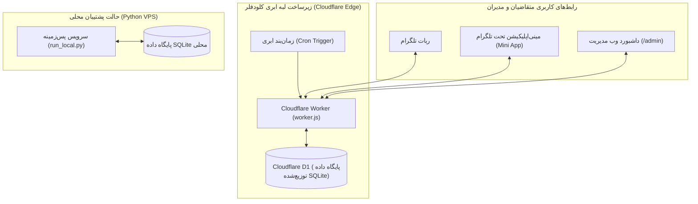

<div align="center">
  
  <h1>سامانه جامع آنلاین «کافی نت لیمو»</h1>
  <p><b>پورتال پیشرفته خدمات الکترونیکی، ربات تلگرام، مینی‌اپلیکیشن (Mini App) و مرکز مدیریت متمرکز</b></p>

  [](https://workers.cloudflare.com/)
  [](https://core.telegram.org/bots)
  [](https://vuejs.org/)
  [](https://developers.cloudflare.com/d1/)
  [](AGENTS.md)
</div>

---

## 📖 معرفی پروژه

سامانه **«کافی نت لیمو»** یک زیرساخت مدرن و دوطرفه برای خودکارسازی و مدیریت خدمات کافی‌نت، امور دانشجویی، استعلامات اداری و خدمات اتباع است. هدف اصلی این محصول، حذف سردرگمی مشتری در سامانه‌های پیچیده دولتی و دانشگاهی است؛ مشتری تنها نوع خدمت را انتخاب کرده، مدارک را ثبت و رسید واریز را بارگذاری می‌کند و تمامی مراحل پردازش توسط مدیریت و اپراتورها در پنل اختصاصی مدیریت و پیگیری می‌شود.

این پروژه منطبق بر اصول بنیادین و سند حاکم [AGENTS.md](AGENTS.md) پیاده‌سازی شده و کلیه بخش‌های آن با ده‌ها آزمون خودکار سرتاسری (E2E) به اثبات رسیده است.

---

## 🌟 قابلیت‌های کلیدی

### ۱. رابط تعاملی تلگرام و مینی‌اپلیکیشن (Telegram Mini App)
- **منوی سبک و سریع متنی:** پیام خوش‌آمدگویی سبک و مدرن بدون اشغال فضای چت با قابلیت به‌روزرسانی درجا (`editMessageText`).
- **مینی‌اپلیکیشن اختصاصی (Vue 3 + TailwindCSS):** محیط کاربرپسند، فارسی و کاملاً واکنش‌گرا (RTL) بدون نیاز به خروج از تلگرام.
- **فرم‌های هوشمند چندمرحله‌ای:** فیلدهای پویا متناسب با هر خدمت (استعلام تاییدیه تحصیلی، کد رهگیری خودنویس مسکن با دو شاهد، سامانه سنجش، ثبت‌نام گلستان پیام‌نور، آموزشیار دانشگاه آزاد، امور اتباع و فیدا).
- **فشرده‌سازی خودکار تصاویر:** تبدیل و بهینه‌سازی مدارک و فیش‌های واریزی در سمت کلاینت با Canvas جهت کاهش مصرف ترافیک.

### ۲. پیگیری لحظه‌ای پرونده و استپر وضعیت (Stepper)
- **شناسه یکتا و رسمی پرونده:** صدور کدهای رهگیری یکتا با ساختار سازمانی (مانند `LIMO-1405-XXXX`).
- **استپر تصویری ۴ مرحله‌ای:**
  1. 🔵 **ثبت پرونده و مدارک**
  2. ⏳ **بررسی و تأیید واریز/مدارک توسط اپراتور**
  3. ⚙️ **اقدام و پردازش در سامانه مرجع**
  4. ✅ **تکمیل خدمت و تحویل نتیجه**
- **عایق‌بندی اطلاعاتی:** حفاظت کامل از اطلاعات خصوصی و ممانعت از مشاهده سوابق یا پرونده سایر کاربران.

### ۳. پنل مدیریت جامع تحت وب (Admin Command Center)
- **احراز هویت دو فاکتوره امن:** الزام درج نام کاربری (`admin`) و رمز عبور بدون افشای رمز در کلاینت.
- **کارتابل پرونده‌ها و تأیید رسیدها:** مشاهده اسناد و فیش‌های واریزی، تایید مالی، تغییر وضعیت و درج یادداشت‌های داخلی.
- **مدیریت ارتباط با مشتری (CRM):** پرونده یکپارچه هر کاربر شامل سوابق سفارش‌ها، تراکنش‌های مالی و تیکت‌ها.
- **کاتالوگ خدمات و دسته‌بندی‌ها:** افزودن، ویرایش تعرفه‌ها به تومان، تعیین اولویت و فعال/غیرفعال‌سازی خدمات.
- **سیستم ثبت‌نام‌های مقطعی و مهلت‌دار:** مدیریت رویدادهای فصلی همراه با شمارش معکوس و یادآورهای خودکار.

### ۴. سیستم گفت‌وگوی زنده پشتیبانی و تیکتینگ دوطرفه (Live Chat)
- امکان شروع چت برخط با دستور `/chat` یا دکمه «ارتباط با اپراتور».
- ارسال و دریافت پیام، اسکرین‌شات و مدارک بین متقاضی و اپراتور.
- پنل پاسخگویی زنده در داشبورد وب مدیریت با ارسال پیام مستقیم به حساب تلگرام مشتری.
- پایان امن گفت‌وگو با دکمه اختصاصی یا دستور `/endchat`.

### ۵. پایشگر هوشمند سامانه‌ها (Smart Uptime & Registration Monitor)
- ارزیابی خودکار و دوره‌ای (Cron Trigger هر ۵ دقیقه) سامانه‌های کلیدی کشور:
  1. سامانه ثبت نوبت تثبیت هویت اتباع (`ivsf.nsia.gov.af`)
  2. پورتال امور دانشجویان بین‌الملل - ادب (`adab.saorg.ir`)
  3. سامانه گلستان دانشگاه پیام نور (`osreg.pnu.ac.ir`)
  4. سامانه آموزشیار دانشگاه آزاد اسلامی (`edu.iau.ac.ir`)
  5. سازمان سنجش آموزش کشور (`sanjesh.org`)
  6. سامانه تاییدیه تحصیلی آموزش و پرورش (`emt.medu.ir`)
- **اصل تفکیک پایش:** تمایز فنی و هوشمند میان در دسترس بودن سرور (HTTP 200) و باز شدن واقعی نوبت‌های ثبت‌نام.

---

## 🏗 معماری فنی (Dual-Mode Architecture)



---

## 📁 ساختار مخزن پروژه

```text
├── assets/                       # فایل‌های گرافیکی رسمی، لوگو و متریال‌های بصری
│   ├── logo.png                  # لوگوی اصلی کافی نت لیمو
│   └── avatar_512.png            # تصویر آواتار پروفایل ربات
├── bot/                          # ماژول‌های پایتون جهت استقرار در سرور مجازی (حالت محلی)
│   ├── dispatcher.py             # هدایت‌کننده رویدادها و دستورات
│   ├── handlers.py               # پردازشگر پیام‌ها و تعاملات
│   ├── fsm.py                    # ماشین وضعیت فرم‌های چندمرحله‌ای
│   └── webapp.py                 # کنترل‌کننده‌های مینی‌اپلیکیشن
├── cloudflare/                   # هسته اجرایی ابری مستقر بر Cloudflare Workers
│   ├── worker.js                 # ورکر جامع لبه ابری (Edge Worker API & Webhook)
│   ├── admin_html.js             # سورس تک‌صفحه‌ای فرانت‌اند داشبورد مدیریت
│   ├── schema.sql                # اسکریپت پایگاه داده D1 و جداول ۱۶ گانه
│   └── wrangler.toml             # پیکربندی محیط، متغیرها و Cron زمان‌بند
├── core/                         # هسته محاسباتی، تنظیمات و مبدل تاریخ شمسی
├── models/                       # مدل‌های داده‌ای، اسکیمای دیتابیس و اعتبارسنجی
├── scripts/                      # اسکریپت‌های مدیریت، مهاجرت داده و آزمون‌های زنده
│   ├── generate_admin_dashboard.py # کامپایلر داشبورد مدیریت Vue 3 به اسکریپت ورکر
│   ├── setup_webhook.py          # مدیریت امن وب‌هوک و اتصال توکن
│   ├── init_db.py                # ابزار ساخت و ارزیابی دیتابیس محلی
│   ├── verify_fixes_live.py      # آزمون زنده رگرسیون و سلامت دکمه‌ها (۳۸ تست)
│   └── verify_phase7_e2e.py      # آزمون سرتاسری و جامع چرخه کامل سیستم (۲۴ تست)
├── services/                     # سرویس‌های تخصصی (کیف پول، مانیتورینگ، تیکتینگ)
├── tests/                        # آزمون‌های واحد و یکپارچگی محلی پایتون (بیش از ۱۰۰ تست)
├── AGENTS.md                     # قانون اساسی، منشور حاکم و ضوابط غیرقابل تغییر پروژه
├── DEPLOYMENT.md                 # راهنمای جامع عملیات، استقرار و اپراتوری
├── run_local.py                  # اسکریپت اجرای محلی ربات (حالت Long-Polling)
└── README.md                     # مستند رسمی پروژه
```

---

## 🚀 راه‌اندازی و استقرار

### پیش‌نیازها
- **Node.js** نسخه ۱۸ به بالا و `npm`
- **Python** نسخه ۳.۱۰ یا بالاتر
- حساب کاربری در **Cloudflare** و ابزار `wrangler`

### ۱. استقرار بر روی Cloudflare Workers (روش پیشنهادی و فعال)
```bash
# ورود به حساب کلودفلر
npx wrangler login

# تنظیم متغیرهای محرمانه
npx wrangler secret put BOT_TOKEN --config=./cloudflare/wrangler.toml
npx wrangler secret put ADMIN_ID --config=./cloudflare/wrangler.toml

# انتشار نهایی بر روی Edge
npx wrangler deploy --config=./cloudflare/wrangler.toml
```

### ۲. اجرای آزمون‌های راستی‌آزمایی زنده
```bash
# اجرای آزمون جامع چرخه کامل سیستم (E2E)
node scripts/verify_phase7_e2e.js

# اجرای آزمون‌های سلامت دکمه‌ها و احراز هویت پنل
node scripts/verify_fixes_live.js
```

---

## 🔒 امنیت و حریم خصوصی

پروژه «کافی نت لیمو» منطبق بر بند ۵ و بند ۱۳ قوانین محرمانگی توسعه یافته است:
- **عدم ذخیره توکن‌ها و کلیدها:** هیچ توکن یا رمز عبوری در سورس‌کد قرار ندارد و کلیه موارد از طریق Cloudflare Secrets تزریق می‌شوند.
- **جلوگیری از حملات نفوذ:** فیلتر کاراکترهای آسیب‌رسان و ایمن‌سازی با `escapeHtml` در تمامی پیام‌های ارسالی.
- **داده‌های ساختگی در تست‌ها:** در تمامی آزمون‌های خودکار و گزارش‌ها منحصراً از داده‌های ساختگی (Mock Data) استفاده شده است.

---

## 📄 مجوز و حقوق مالکیت
کلیه حقوق این سامانه متعلق به مجموعه **کافی نت لیمو** می‌باشد. هرگونه بهره‌برداری تجاری، بازنشر یا استفاده بدون مجوز صریح مالک پروژه ممنوع است.
