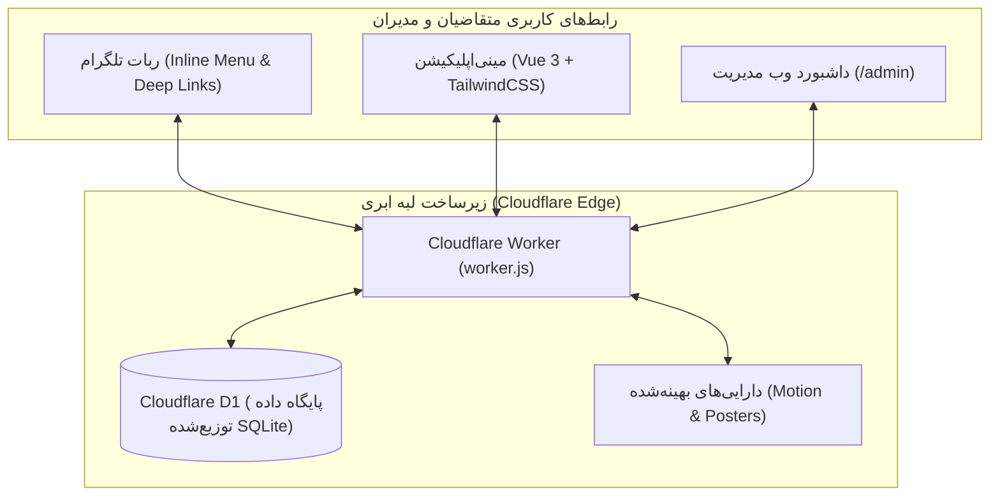

<div align="center">
  
  <h1>سامانه جامع و هوشمند «کافی نت لیمو»</h1>
  <p><b>پورتال پیشرفته خدمات الکترونیکی، ربات تلگرام، مینی‌اپلیکیشن (Telegram Mini App) و مرکز مدیریت متمرکز تحت وب</b></p>

  [](https://workers.cloudflare.com/)
  [](https://core.telegram.org/bots)
  [](https://vuejs.org/)
  [](https://tailwindcss.com/)
  [](https://developers.cloudflare.com/d1/)
  [](AGENTS.md)
</div>

---

## 📖 معرفی سامانه

سامانه **«کافی نت لیمو»** یک اکوسیستم جامع، مدرن و دومنظوره برای خودکارسازی، ثبت و پردازش امور کافی‌نت، خدمات اداری، استعلامات تحصیلی، امور دانشجویی و خدمات ویژه اتباع است. این سیستم به گونه‌ای مهندسی شده که متقاضیان بتوانند بدون سردرگمی در پورتال‌های دولتی، خدمات مورد نظر خود را در محیط روان تلگرام یا مینی‌اپلیکیشن انتخاب کرده، مدارک را ارسال کنند و مراحل انجام خدمت را به صورت گام‌به‌گام پیگیری نمایند.

تمامی عملیات مدیریتی، بررسی مدارک و وضعیت‌دهی پرونده‌ها از طریق یک پنل تحت وب با کارایی بالا مدیریت می‌شود. کل سامانه بر پایه سند مرجع و قوانین [AGENTS.md](AGENTS.md) پیاده‌سازی شده و تمامی قابلیت‌ها با ده‌ها آزمون خودکار سرتاسری اعتبارسنجی شده‌اند.

---

## 🌟 قابلیت‌های برجسته سیستم

### ۱. مینی‌اپلیکیشن تلگرام (Telegram Mini App)
- **تاب‌آوری بالا در شرایط اختلال شبکه و پروکسی:** مجهز به مخزن بوت‌استرپ آفلاین تعبیه‌شده (`Embedded Offline Fallback`) که مانع از توقف یا سفید شدن صفحه مینی‌اپ هنگام کندی پروکسی یا تایم‌اوت شبکه می‌شود.
- **فرم‌ساز پویا و داینامیک:** رندرر هوشمند انواع فیلدهای متنی، عددی، انتخابی و آپلود مدارک با پشتیبانی از ساختارهای دیکشنری کلید-مقدار و آرایه‌ها.
- **صفحه اختصاصی توضیحات و راهنمای هر خدمت (`service_detail`):** نمایش بنر تصویری، تعرفه رسمی، پیوند به سامانه دولتی مرجع، راهنمای گام‌به‌گام مشتری و چک‌لیست مدارک مورد نیاز پیش از شروع فرم ثبت.
- **لوگوی متحرک (Motion Graphic) فوق‌فشرده:** ویدئوی موشن با کاهش حجم ۹۹.۱٪ (۲۰ کیلوبایت) به همراه پوستر سبک WebP برای اجرای روان و آنی در گوشی‌های اقتصادی.
- **طراحی تمام‌واکنش‌گرا و سازگار با سیستم‌عامل:** بهره‌گیری از `viewport-fit=cover` و حاشیه‌های امن (`safe-area-inset-bottom`) برای ممانعت از تداخل دکمه‌ها با نوار ناوبری اندروید و iOS.

### ۲. ربات تلگرام و منبع اطلاعاتی واحد (Single Source of Truth)
- **هماهنگی ۱۰۰٪ با پنل وب:** دسته‌بندی‌ها، اسامی خدمات، اولویت چینش، توضیحات و وضعیت فعال/غیرفعال بودن در منوی ربات دقیقاً و مستقیماً از پایگاه داده D1 خوانده می‌شوند؛ هیچ مقدار هاردکدشده‌ای وجود ندارد.
- **پیوندهای عمیق دوطرفه (Deep Linking):** امکان باز کردن سریع مینی‌اپلیکیشن مستقیم روی فرم هر خدمت از طریق کلیدهای شیشه‌ای ربات.
- **رهگیری وضعیت پرونده با استپر تصویری:** پیگیری لحظه‌ای پرونده با کدهای سازمانی یکتا (مانند `LIMO-1405-XXXX`) در ۴ مرحله:
  1. 🔵 **ثبت پرونده و مدارک**
  2. ⏳ **بررسی و تأیید واریز/مدارک توسط اپراتور**
  3. ⚙️ **اقدام و پردازش در سامانه مرجع**
  4. ✅ **تکمیل خدمت و تحویل نتیجه**

### ۳. پنل مدیریت پیشرفته تحت وب (Admin Command Center)
- **مرتب‌سازی دیداری کشیدن و رها کردن (Drag & Drop):** تنظیم سریع چینش خدمات، دسته‌بندی‌ها، رویدادهای فصلی و کانال‌های اطلاع‌رسانی با دستگیره بصری `⠿` و ذخیره آنی در دیتابیس D1.
- **انقضای امن نشست و خروج خودکار:** رصد مداوم فعالیت ادمین و خروج امن خودکار پس از ۲۰ دقیقه عدم فعالیت به همراه محافظت رویداد `visibilitychange`.
- **مدیریت ارتباط با مشتری (CRM) و سطل بازیافت:** ثبت سوابق مشتریان، جستجوی بلادرنگ، حذف ایمن و امکان بازگردانی داده‌های حذف‌شده (Soft Delete).
- **سیستم مدیریت رویدادهای مقطعی:** مدیریت ثبت‌نام‌های زمان‌دار (مانند کنکور، وام دانشجویی، سرشماری) با تاریخ شروع و پایان و شمارش معکوس.
- **رابط کاربری کاملاً ریسپانسیو:** سایدبار کشویی مدرن (Off-canvas Drawer) برای موبایل و تبلت، و اسکرول افقی استاندارد در تمامی جداول داده.

### ۴. سیستم گفت‌وگوی زنده پشتیبانی (Live Chat & Ticketing)
- ارتباط دوطرفه بین مشتری و اپراتور از طریق دستور `/chat` یا دکمه پشتیبانی.
- کارتابل زنده پاسخگویی در پنل وب با ارسال مستقیم پاسخ به تلگرام مشتری.
- قابلیت خاتمه امن گفت‌وگو و ثبت گزارش در سوابق CRM.

---

## 🔮 نقشه راه و قابلیت‌های آینده (Future Roadmap)

این قابلیت‌ها به عنوان طرح‌های توسعه فازهای آتی مستند شده‌اند:

### ۱. اتوماسیون گفت‌وگو در تلگرام بیزینس (Chat Automation)
- **مستند معماری:** رجوع شود به سند اختصاصی [telegram_business_chat_automation_plan.md](telegram_business_chat_automation_plan.md).
- **شرح قابلیت:** اتصال رسمی ربات به اکانت شخصی یا کاری مدیر از طریق Telegram Business API؛ پاسخگویی خودکار در پی‌وی به نیابت از مدیر، هدایت هوشمند به مینی‌اپلیکیشن، جلوگیری از ریزش مراجعین شخصی، و تفکیک چت‌های خصوصی با تنظیمات `Excluded chats` و بازه خنک‌سازی ضد اسپم (Cooldown).

### ۲. دستیار هوشمند و موتور پاسخگویی به اسناد (AI Assistant & RAG Engine)
- **مستند معماری:** رجوع شود به سند جامع [future_ai_assistant_architecture_blueprint.md](future_ai_assistant_architecture_blueprint.md).
- **شرح قابلیت:** پاسخگویی بدون توهم (Zero-Hallucination) به پرسش‌های متداول مشتریان بر پایه پایگاه دانش مصوب، هدایت خودکار متقاضی به فرم‌های مربوطه و ارجاع آنی پرونده‌های پیچیده به کارشناس انسانی (Human Handoff).

---

## 🏗 معماری فنی و جریان داده



---

## 📁 ساختار مخزن پروژه

```text
├── assets/                       # متریال‌های بصری و دارایی‌های گرافیکی
│   ├── motion/                   # فایل‌های موشن لوگو و انیمیشن تلگرام فوق‌فشرده
│   │   ├── logo_motion_320p.mp4  # ویدئوی ۲۰ کیلوبایتی وب
│   │   └── logo_poster.webp      # پوستر ۲.۸ کیلوبایتی
│   ├── logo.png                  # نشان رسمی کافی‌نت لیمو
│   └── avatar_512.png            # آواتار پروفایل تلگرام
├── cloudflare/                   # هسته مستقر بر سرورهای لبه کلودفلر
│   ├── worker.js                 # کنترل‌کننده ورکر ابری (API، وب‌هوک و رندرینگ)
│   ├── admin_html.js             # سورس مستقل داشبورد مدیریت وب
│   ├── miniapp_html.js           # سورس مستقل مینی‌اپلیکیشن تلگرام
│   ├── motion_assets.js          # سرویس دارایی‌های باینری فشرده‌شده
│   ├── schema.sql                # اسکیمای دیتابیس D1
│   └── wrangler.toml             # پیکربندی محیط کلودفلر
├── scripts/                      # ابزارهای ساخت، کامپایل و آزمون‌های خودکار
│   ├── compile_miniapp.py        # کامپایلر مینی‌اپلیکیشن با پشتیبانی آفلاین
│   ├── generate_admin_dashboard.py # تولیدکننده داشبورد مدیریت Vue 3
│   ├── dashboard_parts/          # ماژول‌های ۵‌گانه پنل ادمین (سایدبار، فرم‌ها، کنترلر)
│   ├── test_step1_miniapp_resilience.mjs # آزمون تاب‌آوری و فرم‌ساز مینی‌اپ
│   ├── test_step2_motion_assets.mjs      # آزمون فشرده‌سازی موشن‌گرافیک
│   ├── test_step3_admin_revamp.mjs       # آزمون درگ‌اند‌دراپ و امنیت نشست
│   ├── test_step4_single_source_sync.mjs # آزمون همگامی ربات و مینی‌اپ
│   └── test_step5_responsive_qa.mjs      # آزمون واکنش‌گرایی موبایل و دسکتاپ
├── bot/                          # ماژول‌های پایتون برای سرورهای محلی / شبیه‌سازی
├── core/                         # هسته محاسباتی و توابع کمکی
├── models/                       # مدل‌های داده و اسکیمای ساختاریافته
├── services/                     # سرویس‌های کیف‌پول و پشتیبانی
├── tests/                        # آزمون‌های واحد و سیستمی پایتون (۱۵۷ تست)
├── AGENTS.md                     # سند حاکم و قوانین دائمی توسعه پروژه
├── DEPLOYMENT.md                 # راهنمای جامع استقرار و تنظیم وب‌هوک
└── README.md                     # مستند رسمی و مشخصات سیستم
```

---

## 🚀 راه‌اندازی و استقرار

### ۱. استقرار بر روی Cloudflare Workers (روش پیشنهادی)
```bash
# نصب وابستگی‌ها
npm install

# کامپایل فرانت‌اندها
python scripts/generate_admin_dashboard.py
python scripts/compile_miniapp.py

# تنظیم توکن‌های محرمانه
npx wrangler secret put BOT_TOKEN --config=./cloudflare/wrangler.toml
npx wrangler secret put ADMIN_ID --config=./cloudflare/wrangler.toml

# استقرار روی لبه کلودفلر
npx wrangler deploy --config=./cloudflare/wrangler.toml
```

### ۲. اجرای آزمون‌های سلامت و کنترل کیفیت
```bash
# اجرای آزمون‌های خودکار ۵ گانه جاوااسکریپت
node scripts/test_step1_miniapp_resilience.mjs
node scripts/test_step2_motion_assets.mjs
node scripts/test_step3_admin_revamp.mjs
node scripts/test_step4_single_source_sync.mjs
node scripts/test_step5_responsive_qa.mjs

# اجرای مجموعه آزمون‌های پایتون (۱۵۷ آزمون)
python -m unittest discover tests
```

---

## 🔒 امنیت، محرمانگی و استانداردها

توسعه سیستم بر اساس اصول سخت‌گیرانه مندرج در [AGENTS.md](AGENTS.md) صورت گرفته است:
- **حفاظت از کلیدها و توکن‌ها:** هیچ رمز عبور یا کلید دسترسی در گیت نگهداری نمی‌شود و منحصراً از طریق Cloudflare Secrets تزریق می‌گردد.
- **ایمن‌سازی در برابر حملات تزریق (XSS & Injection):** پالایش ورودی‌ها و فرار کاراکترهای مخرب (`escapeHtml`) در تمامی سطوح.
- **داده‌های ساختگی در محیط آزمون:** در تمامی آزمون‌های خودکار از داده‌های ساختگی (Mock Data) استفاده شده و اطلاعات واقعی هیچ کاربری استفاده نمی‌شود.
- **احراز هویت و مدیریت نشست:** احراز هویت قوی برای پنل مدیریت، رصد فعالیت و خروج خودکار پس از ۲۰ دقیقه عدم تعامل.

---

## 📄 مجوز و مالکیت
کلیه حقوق این سامانه متعلق به مجموعه **کافی نت لیمو** است.
